# Enterprise Kubernetes Platform Engineering on AWS EKS

[](https://kubernetes.io/)
[](https://aws.amazon.com/)
[](https://www.terraform.io/)
[](https://argo-cd.readthedocs.io/)
[](https://karpenter.sh/)
[](https://kyverno.io/)
[](https://prometheus.io/)

Production-oriented Kubernetes platform engineering project demonstrating the design and implementation of an enterprise-style application platform on **Amazon EKS**.

The platform combines:

- Infrastructure as Code
- managed Kubernetes
- GitOps
- Gateway API
- automated DNS
- automated TLS
- external secrets management
- policy-as-code
- Kubernetes network security
- observability
- workload autoscaling
- event-driven autoscaling
- dynamic node provisioning
- persistent storage

The objective was not simply to deploy an application to Kubernetes, but to build the surrounding **platform capabilities required to operate Kubernetes workloads reliably, securely, and declaratively**.

---

# 1. Project Overview

Modern Kubernetes environments require substantially more than a running cluster.

A production platform must address questions such as:

- How is the underlying cloud infrastructure created consistently?
- How are Kubernetes changes deployed and reconciled?
- How are workloads exposed to users?
- How are DNS records created?
- How are TLS certificates issued and renewed?
- How are application secrets retrieved securely?
- How are unsafe workloads prevented from entering the cluster?
- How is network communication restricted?
- How are workloads monitored?
- How are applications scaled?
- How is cluster compute capacity scaled?
- How is persistent storage dynamically provisioned?

This project implements those capabilities as an integrated Kubernetes platform running on AWS.

---

# 2. Problem Statement

A Kubernetes cluster by itself does not provide a complete production application platform.

Without additional platform engineering controls, organizations commonly face:

- manually created cloud infrastructure
- configuration drift
- inconsistent deployments
- direct production changes
- manually maintained DNS
- manual certificate management
- Kubernetes Secrets containing long-lived credentials
- privileged or improperly configured containers
- unrestricted pod-to-pod communication
- insufficient monitoring
- inefficient static node capacity
- poor workload scaling
- inconsistent persistent storage provisioning

This project addresses those problems through a declarative platform architecture.

---

# 3. High-Level Architecture

The platform combines Terraform-provisioned AWS infrastructure with GitOps-managed Kubernetes services on Amazon EKS.

The following diagram presents the end-to-end platform architecture, including infrastructure provisioning, GitOps reconciliation, traffic management, security controls, observability, workload autoscaling, dynamic node provisioning, persistent storage, and AWS service integrations.

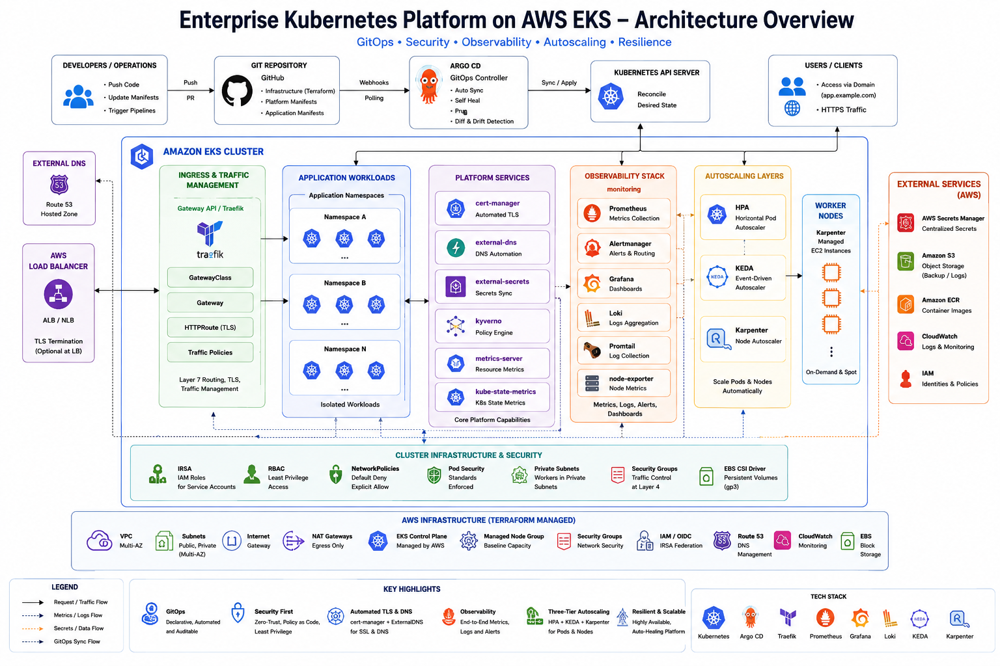

## Architecture at a Glance

The platform is organized into several integrated engineering layers:

- **Infrastructure as Code** — Terraform provisions AWS networking, Amazon EKS, IAM, OIDC/IRSA, managed node capacity, and supporting infrastructure.
- **GitOps** — Argo CD continuously reconciles Kubernetes desired state from Git using the App-of-Apps pattern.
- **Traffic Management** — Kubernetes Gateway API and Traefik provide external application routing through shared gateway infrastructure.
- **DNS and TLS Automation** — ExternalDNS integrates Kubernetes with Amazon Route 53, while cert-manager automates certificate lifecycle management.
- **Security** — IRSA, Kyverno, NetworkPolicies, private worker nodes, security groups, External Secrets, and Kubernetes RBAC provide layered security controls.
- **Observability** — Prometheus, Grafana, Alertmanager, kube-state-metrics, and node-exporter provide metrics collection, visualization, alerting, and infrastructure visibility.
- **Workload Autoscaling** — HPA provides resource-based pod scaling, while KEDA provides Prometheus-driven autoscaling.
- **Infrastructure Autoscaling** — Karpenter dynamically provisions EC2 capacity when Kubernetes workloads require additional compute and consolidates capacity when demand decreases.
- **Persistent Storage** — the Amazon EBS CSI driver and `gp3` StorageClass provide dynamic persistent-volume provisioning.

The architecture separates infrastructure provisioning from Kubernetes platform lifecycle management:

```text
                   Git Repository
                         |
                         v
                      Argo CD
                         |
                         v
               Kubernetes Desired State
                         |
                         v
                    Amazon EKS
                         ^
                         |
                 AWS Infrastructure
                         ^
                         |
                      Terraform
```

Terraform manages the underlying AWS infrastructure, while Argo CD manages the Kubernetes platform desired state stored in Git.

Application traffic follows a separate runtime path:

```text
Internet
   |
   v
Amazon Route 53
   |
   v
AWS Load Balancer
   |
   v
Kubernetes Gateway API
   |
   v
Traefik Gateway
   |
   v
HTTPRoute
   |
   v
Application Workloads
```

Platform controllers provide supporting capabilities around those workloads:

```text
Application Workloads
        |
        +------> Prometheus ------> Grafana / Alertmanager
        |
        +------> HPA / KEDA ------> Replica Scaling
        |
        +------> Karpenter -------> Dynamic EC2 Capacity
        |
        +------> Kyverno ---------> Admission Policy Enforcement
        |
        +------> NetworkPolicy ---> Network Isolation

External Secrets ------> AWS Secrets Manager
ExternalDNS -----------> Amazon Route 53
cert-manager ----------> Automated TLS Certificates
EBS CSI Driver --------> Amazon EBS / gp3
```

This architecture provides three complementary control loops:

**Infrastructure reconciliation**

```text
Terraform -> AWS Infrastructure -> Amazon EKS
```

**Platform reconciliation**

```text
Git -> Argo CD -> Kubernetes Desired State
```

**Runtime elasticity**

```text
Metrics / Events
      |
      v
HPA / KEDA
      |
      v
Pod Scaling
      |
      v
Karpenter
      |
      v
EC2 Node Capacity
```

Together, these layers provide a declarative, secure, observable, and dynamically scalable Kubernetes platform rather than simply an EKS cluster.

For a detailed discussion of the architecture and individual platform components, see:

[`docs/architecture.md`](docs/architecture.md)

---
# 4. Core Platform Capabilities

| Capability           | Technology                | Purpose                                 |
| -------------------- | ------------------------- | --------------------------------------- |
| Cloud Infrastructure | Terraform                 | Declarative AWS infrastructure          |
| Managed Kubernetes   | Amazon EKS                | Kubernetes control plane                |
| Networking           | Amazon VPC                | Network isolation and routing           |
| Identity             | AWS IAM + OIDC/IRSA       | Pod-level AWS access                    |
| GitOps               | Argo CD                   | Continuous desired-state reconciliation |
| Traffic Management   | Kubernetes Gateway API    | Modern application routing              |
| Gateway Controller   | Traefik                   | Gateway API implementation              |
| DNS Automation       | ExternalDNS               | Route 53 record management              |
| TLS Automation       | cert-manager              | Certificate lifecycle automation        |
| Secrets              | External Secrets Operator | External secret synchronization         |
| Policy Enforcement   | Kyverno                   | Kubernetes policy-as-code               |
| Network Security     | NetworkPolicy             | Pod communication restrictions          |
| Metrics              | Prometheus                | Metrics collection                      |
| Visualization        | Grafana                   | Dashboards and observability            |
| Alerting             | Alertmanager              | Alert routing                           |
| Resource Metrics     | Metrics Server            | Kubernetes resource metrics             |
| Workload Scaling     | HPA                       | CPU/resource-based scaling              |
| Event Scaling        | KEDA                      | Prometheus/event-driven scaling         |
| Node Provisioning    | Karpenter                 | Dynamic EC2 capacity                    |
| Persistent Storage   | AWS EBS CSI               | Kubernetes persistent volumes           |
| Storage Class        | gp3                       | AWS EBS dynamic provisioning            |

---

# 5. Platform Engineering Principles

Several engineering principles guided the implementation.

### Declarative Infrastructure

AWS infrastructure is defined through Terraform rather than being manually created.

This improves:

```text
reproducibility
auditability
consistency
disaster recovery
environment recreation
```

### Git as Desired State

Kubernetes platform configuration is stored in Git.

Argo CD continuously compares:

```text
Git Desired State
        |
        v
Argo CD Reconciliation
        |
        v
Kubernetes Live State
```

This reduces configuration drift and discourages unmanaged production changes.

### Separation of Platform and Application Concerns

The repository separates:

```text
infrastructure
platform components
GitOps configuration
application configuration
environment configuration
documentation
```

This mirrors the separation commonly used by platform engineering teams.

### Least-Privilege Cloud Access

Kubernetes workloads requiring AWS API access use:

```text
Kubernetes ServiceAccount
          |
          v
        OIDC
          |
          v
        IRSA
          |
          v
      AWS IAM Role
```

Applications do not require static AWS credentials stored inside container images.

### Defense in Depth

Security controls exist across multiple layers:

```text
AWS IAM
   +
Private Networking
   +
TLS
   +
External Secrets
   +
Kyverno
   +
NetworkPolicy
   +
Resource Controls
   +
Encrypted Storage
```
---

# 6. Repository Structure
```
eks-enterprise-kubernetes-platform/
|
├── applications/
│   └── online-boutique/
|
├── argocd/
│   ├── applications/
│   ├── app-of-apps/
│   ├── bootstrap/
│   └── projects/
|
├── clusters/
│   ├── dev/
│   ├── staging/
│   └── prod/
|
├── platform/
│   ├── autoscaling/
│   ├── cert-manager/
│   ├── external-dns/
│   ├── external-secrets/
│   ├── gateway-api/
│   ├── karpenter/
│   ├── keda/
│   ├── kyverno/
│   ├── metrics-server/
│   ├── network-policies/
│   ├── observability/
│   ├── storage/
│   └── traefik-gateway/
|
├── terraform/
│   └── aws/
|
├── manifests/
├── docs/
├── diagrams/
├── scripts/
├── Makefile
└── README.md
```
This structure separates infrastructure provisioning from Kubernetes platform configuration and GitOps orchestration.

---

# 7. Infrastructure as Code

Terraform provisions the AWS infrastructure required by the platform.

The infrastructure layer includes:

- VPC
- public subnets
- private subnets
- routing
- NAT connectivity
- security groups
- EKS
- managed worker nodes
- IAM roles
- OIDC integration
- EKS add-ons
- supporting IAM resources

Conceptually:

```
Terraform
    |
    v
AWS Infrastructure
    |
    +--> VPC
    |
    +--> Public Subnets
    |
    +--> Private Subnets
    |
    +--> IAM
    |
    +--> EKS Control Plane
    |
    +--> Managed Node Group
    |
    +--> EKS Add-ons
```
### Deployed AWS Infrastructure

The Terraform-managed development environment was validated directly through the AWS API after provisioning. The running environment included the Amazon EKS cluster, project VPC, multi-subnet networking, and managed worker-node group.

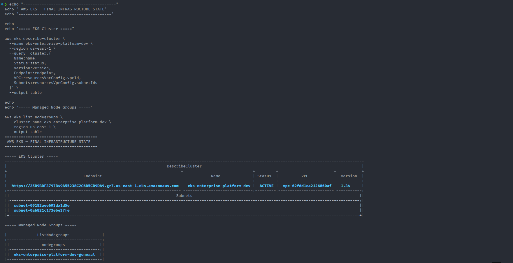

The infrastructure remained reproducible through Terraform, with networking, EKS, IAM, OIDC integration, add-ons, and supporting platform resources maintained as Infrastructure as Code.

---

# 8. Amazon EKS Architecture

Amazon EKS provides the managed Kubernetes control plane.

Worker nodes operate inside the project VPC.

The implementation uses AWS-managed Kubernetes integrations including:
```
Amazon VPC CNI
CoreDNS
kube-proxy
Amazon EBS CSI
```
The architecture separates the managed Kubernetes control plane from worker compute capacity.

### EKS Worker Node Validation

The provisioned managed node group was validated after cluster bootstrap. All worker nodes successfully registered with the EKS control plane and reached the Kubernetes `Ready` state.

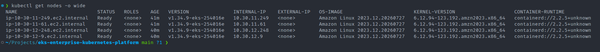

The worker nodes were deployed without public IP addresses, keeping application compute within the VPC networking model rather than directly exposing worker instances to the Internet.

---

# 9. GitOps with Argo CD

Argo CD is responsible for deploying and continuously reconciling Kubernetes platform components.

The repository uses an App-of-Apps pattern.
```
Bootstrap
    |
    v
Root Argo CD Application
    |
    v
+-----------------------------+
| Platform Applications       |
+-----------------------------+
| cert-manager                |
| ExternalDNS                 |
| External Secrets            |
| Gateway API                 |
| Traefik                     |
| Kyverno                     |
| Metrics Server              |
| Prometheus / Grafana        |
| KEDA                        |
| Karpenter                   |
| Network Policies            |
+-----------------------------+
```
Once Argo CD is bootstrapped, the majority of the Kubernetes platform is reconstructed through GitOps.

Argo CD provides:
```
automated synchronization
pruning
self-healing
application health visibility
declarative deployment
Git-based audit history
```
### GitOps Platform Convergence

The final platform state was validated through Argo CD after all platform components had reconciled successfully.

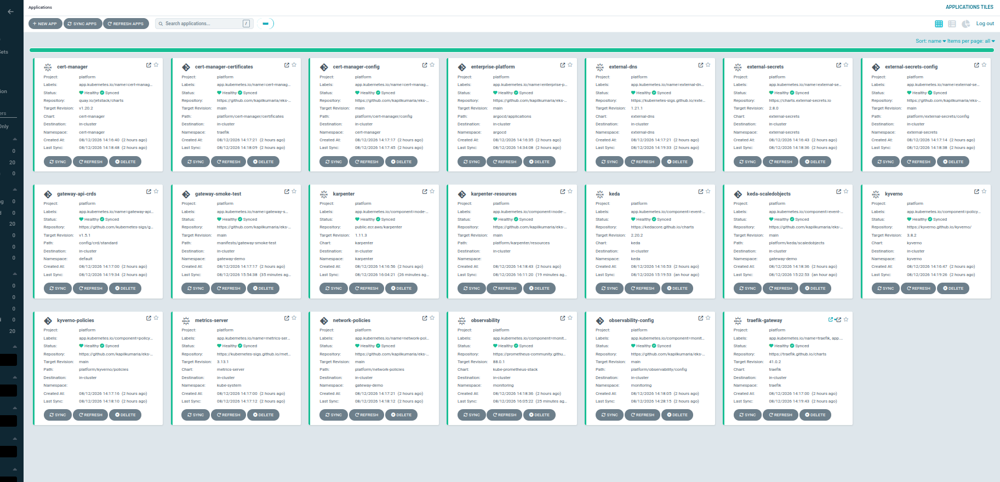

The final Argo CD view demonstrates successful GitOps reconciliation across the platform, including:

- cert-manager
- ExternalDNS
- External Secrets Operator
- Gateway API
- Traefik
- Kyverno
- NetworkPolicies
- Metrics Server
- Prometheus / Grafana
- KEDA
- Karpenter

The platform applications converged to **Synced / Healthy**, demonstrating that the operational state of the cluster could be reconstructed from version-controlled desired state rather than manual cluster configuration.

---

# 10. Kubernetes Gateway API

Application ingress is implemented using the Kubernetes Gateway API rather than relying exclusively on the traditional Ingress API.

Primary resources include:
```
GatewayClass
     |
     v
Gateway
     |
     v
HTTPRoute
     |
     v
Service
     |
     v
Pods
```
Traefik acts as the Gateway API controller.

This provides a structured separation between infrastructure-level gateway configuration and application routing configuration.

---

# 11. Automated DNS

ExternalDNS integrates Kubernetes resources with Amazon Route 53.

The desired flow is:
```
Gateway / Route
       |
       v
ExternalDNS
       |
       v
Amazon Route 53
       |
       v
DNS Record
```
This removes the requirement to manually create DNS records whenever Kubernetes endpoints change.

---

# 12. Automated TLS

cert-manager provides certificate lifecycle automation.

The platform integrates:

```
cert-manager
      |
      v
Let's Encrypt / ACME
      |
      v
Certificate
      |
      v
Kubernetes TLS Secret
      |
      v
Gateway HTTPS Listener
```
This architecture enables automated certificate issuance and renewal.

### Gateway and TLS Runtime Validation

The public application route was validated through the complete ingress path after DNS and certificate reconciliation.

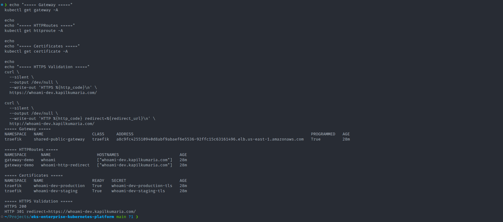

The runtime validation confirmed:

- the shared Traefik Gateway was `Programmed=True`
- HTTPRoutes were present for the application
- staging and production certificates were `Ready=True`
- HTTPS requests returned `HTTP 200`
- HTTP traffic was redirected to HTTPS

This validates the integrated traffic path rather than only verifying that the individual Kubernetes resources existed.

---

# 13. External Secrets Management

Application secrets are not intended to be managed directly as plaintext values in Git.

External Secrets Operator integrates Kubernetes workloads with AWS Secrets Manager, allowing application secrets to remain outside the Git repository while still being synchronized into Kubernetes when required.

Conceptually:

```text
AWS Secrets Manager
        |
        v
External Secrets Operator
        |
        v
ClusterSecretStore
        |
        v
ExternalSecret
        |
        v
Kubernetes Secret
        |
        v
Application Pod
```
AWS access is provided using IAM/OIDC integration rather than embedding long-lived AWS credentials inside workloads.

### External Secrets Runtime Validation

The integration with AWS Secrets Manager was validated against the running EKS environment.

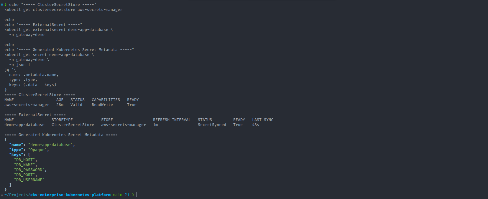

Runtime validation confirmed that:

- the ClusterSecretStore was successfully connected to AWS Secrets Manager
- the ClusterSecretStore reported Valid and Ready=True
- the application ExternalSecret reached SecretSynced and Ready=True
- the resulting Kubernetes Secret contained the expected application database keys
- AWS authentication was performed through workload identity/IAM integration rather than static AWS credentials stored in Git

The synchronized application secret contained the expected keys:
```
DB_HOST
DB_NAME
DB_PASSWORD
DB_PORT
DB_USERNAME
```
This validates the complete secrets-management path:
```
AWS Secrets Manager
        |
        v
IAM / OIDC Authentication
        |
        v
External Secrets Operator
        |
        v
ClusterSecretStore
        |
        v
ExternalSecret
        |
        v
Kubernetes Secret
        |
        v
Application Workload
```
This approach separates secret values from application manifests and GitOps configuration while allowing Kubernetes workloads to consume externally managed secrets.

---

# 14. Policy as Code with Kyverno

Kyverno provides Kubernetes admission policy enforcement.

Two policies were implemented and validated:

### Disallow Privileged Containers

Privileged containers are rejected in the protected application namespace.

### Require Resource Requests and Limits

Application containers must specify CPU and memory requests and limits.

The enforcement path is:
```
kubectl apply
      |
      v
Kubernetes API Server
      |
      v
Kyverno Admission Webhook
      |
      v
ClusterPolicy
      |
      +---- compliant ----> admitted
      |
      +---- violation ----> rejected
```
The policies were validated using negative tests.

A privileged Pod was intentionally submitted and rejected:
```
admission webhook "validate.kyverno.svc-fail" denied the request

disallow-privileged-containers:
Privileged containers are prohibited in application namespaces.
```
A Pod without CPU and memory requests/limits was also intentionally submitted and rejected.

This demonstrates that the policies were not only installed but functionally tested.

### Admission Policy Enforcement Validation

Policy enforcement was validated through negative testing rather than relying only on the existence of `ClusterPolicy` resources.

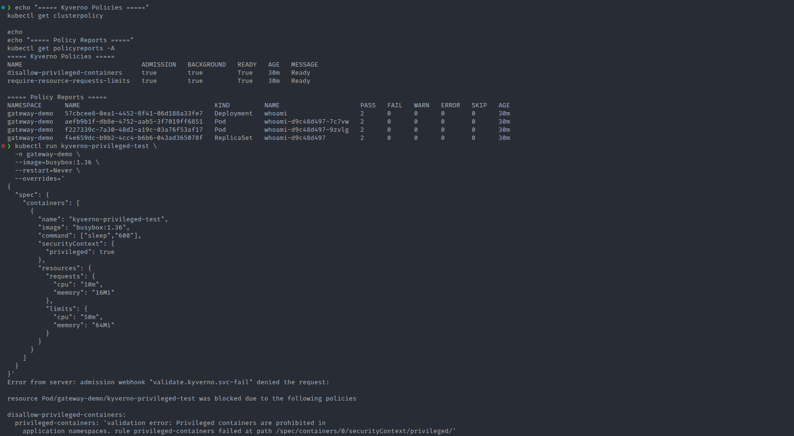

The validation demonstrates both healthy Kyverno policies and an intentional privileged-container deployment being rejected by the admission webhook.

This confirms that the control operated in the Kubernetes admission path and actively prevented non-compliant workloads from entering the protected application namespace.

---

# 15. Kubernetes Network Security

Kubernetes `NetworkPolicy` resources implement application-level network segmentation and restrict unnecessary east-west communication between workloads.

The protected application namespace uses a default-deny security model with explicitly permitted traffic.

The implemented controls include:

```text
default-deny ingress
default-deny egress
explicit DNS egress
explicit Traefik-to-application ingress
```

The network security model follows:

```text
Default Deny
     |
     +--> Explicit DNS Egress
     |
     +--> Explicit Gateway Traffic
     |
     +--> Other Traffic Denied
```

This follows a least-privilege networking approach: workloads are denied network communication by default and only explicitly required communication paths are permitted.

### NetworkPolicy Runtime Validation

The application namespace was validated with the implemented Kubernetes NetworkPolicies active.

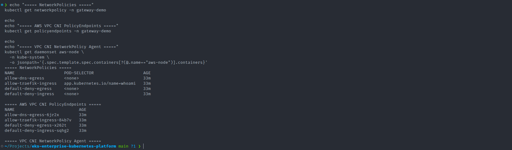

The validation confirmed that the protected namespace contained:

- a default-deny ingress policy
- a default-deny egress policy
- an explicit DNS egress policy
- an explicit Traefik-to-application ingress policy

The implemented policy set was:

```text
00-default-deny-ingress
10-allow-traefik-ingress
20-default-deny-egress
30-allow-dns-egress
```

The resulting traffic model is:

```text
Traefik Gateway
       |
       | explicitly allowed
       v
Application Pods

Application Pods
       |
       | DNS explicitly allowed
       v
Cluster DNS

Other Unapproved Traffic
       |
       X
     Denied
```

This reduces unrestricted pod-to-pod communication and demonstrates defense in depth by combining Kubernetes network segmentation with AWS VPC networking, security groups, IAM controls, TLS, admission policies, and external secrets management.

---

# 16. Observability

The platform includes a Kubernetes-native observability stack based on:

```text
Prometheus
Grafana
Alertmanager
kube-state-metrics
node-exporter
Prometheus Operator
ServiceMonitors
PrometheusRules
```

The monitoring architecture follows:

```text
Kubernetes Cluster
        |
        +--> Node Metrics
        |
        +--> Pod Metrics
        |
        +--> Kubernetes Object Metrics
        |
        +--> Application / Controller Metrics
        |
        v
    Prometheus
        |
        +------> Grafana
        |
        +------> Alertmanager
        |
        +------> KEDA
```

Prometheus provides the central metrics platform used for operational visibility, alerting, and Prometheus-driven KEDA autoscaling.

### Observability Stack Runtime Validation

The complete monitoring stack was validated in the running EKS cluster.

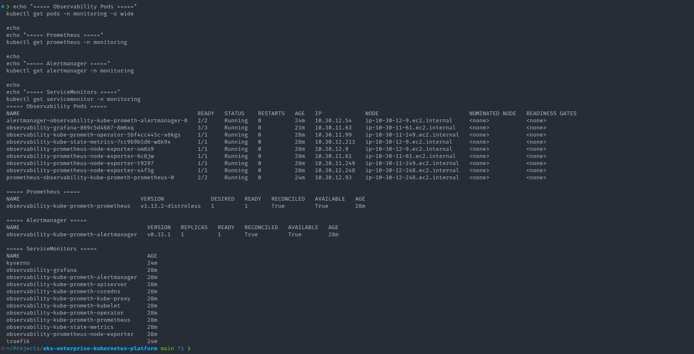

Runtime validation confirmed that the primary observability components were operational, including:

- Prometheus Operator
- Prometheus
- Grafana
- Alertmanager
- kube-state-metrics
- node-exporter
- ServiceMonitor resources
- PrometheusRule resources

This demonstrates that observability was implemented as an integrated platform capability rather than as an isolated dashboard installation.

### Grafana Kubernetes Cluster Dashboard

Live Kubernetes telemetry collected by Prometheus was visualized through Grafana.

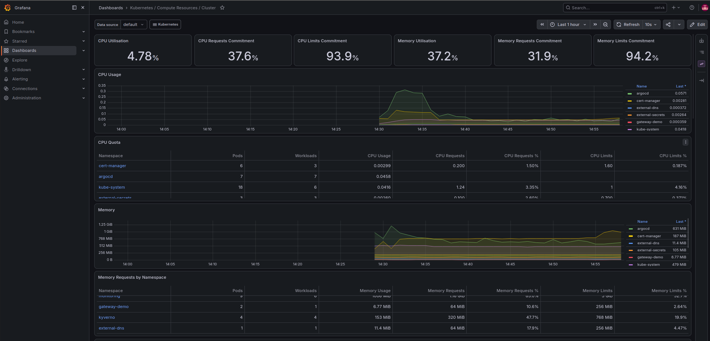

The dashboard provides cluster-level visibility into:

- CPU utilization
- CPU requests and limits
- memory utilization
- memory requests and limits
- namespace resource consumption
- workload-level resource usage

The observability architecture also supports automated platform behavior.

Prometheus metrics are consumed by KEDA for external metric-driven workload autoscaling:

```text
Kubernetes / Application Metrics
              |
              v
          Prometheus
          /        \
         v          v
     Grafana       KEDA
       |             |
       v             v
 Visualization   Pod Scaling
```

This allows the same telemetry platform to serve multiple operational purposes:

```text
Metrics Collection
       +
Visualization
       +
Alerting
       +
Autoscaling Signals
```

The result is a unified observability layer that provides both human-facing operational insight through Grafana and machine-consumable metrics for automated scaling decisions.

---

# 17. Workload Autoscaling

The platform demonstrates multiple layers of autoscaling.

### Horizontal Pod Autoscaler

HPA provides Kubernetes-native workload scaling based on resource utilization.
```
CPU / Resource Demand
        |
        v
Metrics Server
        |
        v
HPA
        |
        v
Deployment Replicas
```
---

# 18. Event-Driven Autoscaling with KEDA

KEDA extends Kubernetes workload autoscaling beyond standard CPU and memory metrics by allowing workloads to scale from external metric sources.

For this platform, a Prometheus-backed `ScaledObject` was implemented for the `whoami` demonstration workload.

The autoscaling architecture follows:

```text
Application Traffic
        |
        v
Traefik Gateway
        |
        v
Traefik Request Metrics
        |
        v
Prometheus
        |
        v
KEDA Prometheus Trigger
        |
        v
KEDA-managed HPA
        |
        v
Deployment Replicas
```

The implementation was configured with:

```text
ScaledObject: whoami-prometheus
Target:       Deployment/whoami
Minimum:      2
Maximum:      6
Trigger:      Prometheus
```

This demonstrates metric-driven workload autoscaling using Prometheus telemetry rather than relying only on CPU or memory utilization.

### Baseline Before Load

Before generating traffic, the workload was validated at its configured baseline.

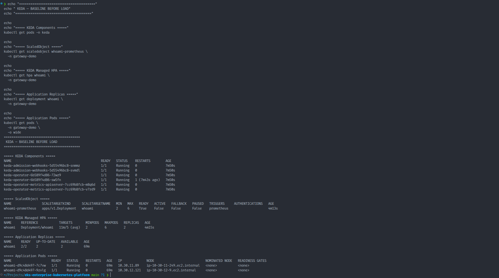

The baseline established the starting state of the scaling test:

```text
Deployment:        whoami
Baseline replicas: 2
Maximum replicas:  6
ScaledObject:      Ready=True
```

Establishing a known baseline was important so that subsequent replica changes could be correlated directly with the generated workload and Prometheus metric.

### Prometheus-Driven Scale Out

Controlled HTTP traffic was then generated through the public Gateway API endpoint.

As request traffic increased, Traefik exposed request metrics that were collected by Prometheus and queried by the KEDA Prometheus scaler.

When the configured metric threshold was exceeded, KEDA activated the `ScaledObject` and the KEDA-managed HPA increased the number of application replicas.

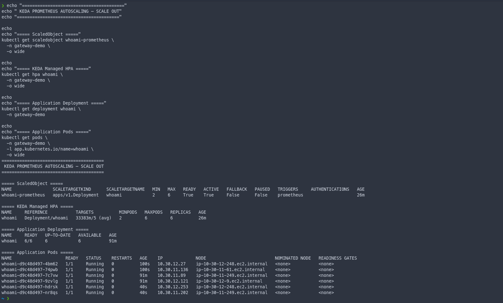

The scale-out validation demonstrated:

```text
ScaledObject:      Ready=True
ScaledObject:      Active=True
Minimum replicas:  2
Maximum replicas:  6

Application scaling:
2 -> 4 -> 6 replicas
```

This confirmed that the external Prometheus metric was successfully influencing Kubernetes workload scaling.

### KEDA-Managed HPA Rescale Events

The scaling decision was also validated through Kubernetes HPA events.

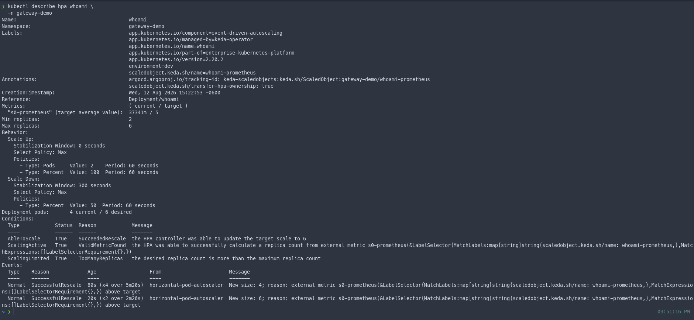

The HPA events provided Kubernetes-level evidence that replica changes were being performed in response to the external metric supplied through KEDA.

The control loop can therefore be represented as:

```text
Prometheus Metric
       |
       v
KEDA Scaler
       |
       v
External Metrics API
       |
       v
KEDA-managed HPA
       |
       v
Deployment Replica Change
```

This is important because it demonstrates the actual interaction between KEDA and Kubernetes HPA rather than only showing that a `ScaledObject` resource existed.

### Scale In and Baseline Recovery

After the generated HTTP traffic was removed, the Prometheus request metric returned toward its idle state.

Following the configured KEDA cooldown and Kubernetes HPA scale-down stabilization behavior, the Deployment returned to its original baseline.

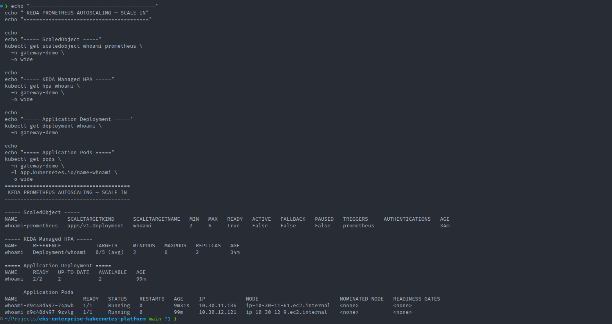

The final state demonstrated:

```text
Generated load:     Removed
Prometheus demand:  Returned toward idle
Deployment replicas:
6 -> 2

Baseline replicas:  2
```

This validated both directions of the workload autoscaling lifecycle:

```text
Baseline
   |
   v
Traffic Increase
   |
   v
Prometheus Metric Increase
   |
   v
KEDA Trigger Active
   |
   v
HPA Scale Out
   |
   v
2 -> 4 -> 6 Pods
   |
   v
Traffic Removed
   |
   v
Metric Decreases
   |
   v
Cooldown / Stabilization
   |
   v
HPA Scale In
   |
   v
6 -> 2 Pods
   |
   v
Baseline Restored
```

The validation demonstrates that KEDA was not merely installed in the cluster; the complete Prometheus-driven autoscaling control loop was functionally tested from metric generation through scale-out and subsequent scale-in.

---

# 19. Dynamic Node Provisioning with Karpenter

Karpenter provides dynamic Kubernetes worker-node provisioning based on actual Kubernetes scheduling requirements.

It operates at a different scaling layer than HPA and KEDA:

```text
Application Demand
       |
       v
HPA / KEDA
       |
       v
Additional Pods
       |
       v
Kubernetes Scheduler
       |
       v
Unschedulable Pods
       |
       v
Karpenter
       |
       v
Dynamic EC2 Capacity
```

Karpenter was configured using:

```text
NodePool
EC2NodeClass
NodeClaims
IAM integration
subnet discovery
security group discovery
instance constraints
Spot / On-Demand capacity support
consolidation behavior
```

This allows Kubernetes compute capacity to respond dynamically to workload scheduling pressure rather than relying exclusively on a statically sized managed node group.

### NodePool and EC2NodeClass Readiness

Before testing dynamic provisioning, the Karpenter infrastructure configuration was validated.

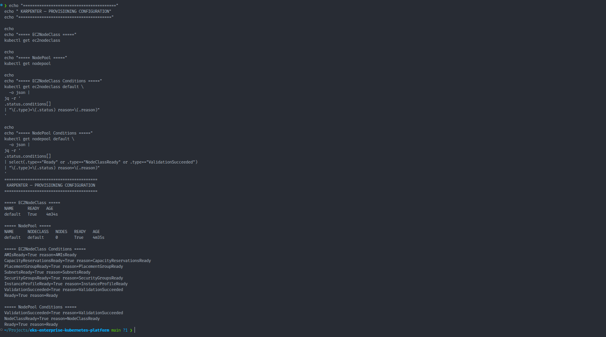

The primary Karpenter resources reached a ready state:

```text
EC2NodeClass/default    Ready=True
NodePool/default        Ready=True
```

The `EC2NodeClass` defines the AWS-specific infrastructure requirements used when provisioning instances, while the `NodePool` defines Kubernetes-level scheduling and capacity constraints.

Together, they provide the configuration Karpenter requires to translate Kubernetes scheduling demand into AWS EC2 capacity.

### Baseline Before Scale Out

Before introducing additional workload demand, the cluster baseline was captured.

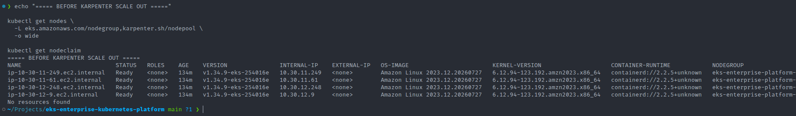

The baseline state was:

```text
Managed EKS nodes:        4
Karpenter NodePool nodes: 0
NodeClaims:               0
```

This established that no Karpenter-provisioned worker capacity existed before the scale-out test.

The four managed EKS nodes therefore represented the cluster's initial compute capacity.

### Dynamic Node Provisioning

Karpenter was then tested using a controlled workload with scheduling requirements that could not be satisfied by the existing cluster capacity.

The provisioning flow was:

```text
Workload Demand
        |
        v
Unschedulable Pods
        |
        v
Karpenter Controller
        |
        v
NodePool
        |
        v
EC2NodeClass
        |
        v
NodeClaim
        |
        v
AWS EC2 Instance
        |
        v
Kubernetes Node Registration
        |
        v
Pending Pods -> Running
```

Karpenter detected the unschedulable workload, evaluated the `NodePool` and `EC2NodeClass` constraints, created a `NodeClaim`, selected suitable EC2 capacity, launched the instance, and registered the new worker with Kubernetes.

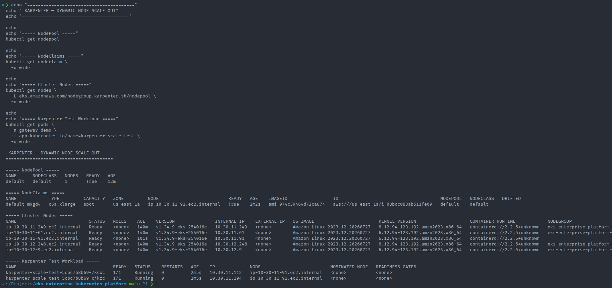

The scale-out validation demonstrated:

```text
Baseline cluster nodes:   4
Karpenter nodes before:   0

During demand:
Karpenter NodeClaims:     1
Karpenter NodePool nodes: 1
Total cluster nodes:      5

Selected capacity:
Instance type:            c5a.xlarge
Capacity type:            Spot
```

This demonstrates that Karpenter responded to Kubernetes scheduling pressure by dynamically provisioning additional infrastructure rather than maintaining a predefined EC2 node count.

### Node Consolidation and Scale-In

After the test workload was removed, Karpenter's consolidation behavior was validated.

The `NodePool` was configured with:

```text
ConsolidationPolicy: WhenEmptyOrUnderutilized
ConsolidateAfter:    1m
```

Once the dynamically provisioned capacity was no longer required, Karpenter identified the unnecessary capacity, removed the `NodeClaim`, and terminated the corresponding EC2 worker.

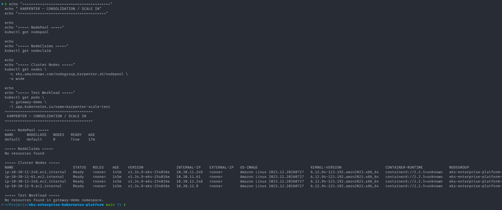

The cluster returned to its original baseline:

```text
Managed EKS nodes:        4
Karpenter NodePool nodes: 0
NodeClaims:               0
Test workload:            removed
```

The complete infrastructure autoscaling lifecycle demonstrated by the test was:

```text
Baseline Cluster
       |
       v
Workload Demand
       |
       v
Unschedulable Pods
       |
       v
Karpenter Detects Capacity Requirement
       |
       v
NodeClaim Created
       |
       v
EC2 Instance Provisioned
       |
       v
Node Joins EKS
       |
       v
Pending Pods Scheduled
       |
       v
Workload Demand Removed
       |
       v
Node Becomes Unnecessary
       |
       v
Karpenter Consolidation
       |
       v
NodeClaim Removed
       |
       v
EC2 Capacity Terminated
       |
       v
Baseline Restored
```

This validates both directions of infrastructure elasticity: **dynamic scale-out when Kubernetes requires additional compute capacity and automated scale-in when that capacity is no longer required**.

It also demonstrates the separation between workload and infrastructure autoscaling:

```text
HPA / KEDA
     |
     | scale application replicas
     v
More Pods
     |
     | may create scheduling pressure
     v
Kubernetes Scheduler
     |
     v
Unschedulable Pods
     |
     v
Karpenter
     |
     | provisions infrastructure
     v
Additional EC2 Capacity
```

KEDA and HPA therefore determine **how many application replicas are required**, while Karpenter determines **whether additional worker-node capacity is required to run those Pods**.

---

# 20. Three Layers of Autoscaling

A key architectural aspect of the project is the separation of autoscaling responsibilities.

| Layer                                | Technology | Responsibility                                  |
| ------------------------------------ | ---------- | ----------------------------------------------- |
| Resource-based workload scaling      | HPA        | Scale Pods based on CPU/resource metrics        |
| Event/metric-driven workload scaling | KEDA       | Scale Pods based on Prometheus/external metrics |
| Infrastructure scaling               | Karpenter  | Provision and remove EC2 worker capacity        |

These scaling mechanisms operate at different layers of the platform.

```text
Traffic / Demand
       |
       v
Application Metrics
       |
       v
HPA / KEDA
       |
       v
Deployment Replica Scaling
       |
       v
Additional Pods
       |
       v
Kubernetes Scheduler
       |
       v
Insufficient Node Capacity
       |
       v
Karpenter
       |
       v
Additional EC2 Capacity
```

HPA and KEDA determine **how many application Pods are required**, while Karpenter determines **whether additional infrastructure is required to schedule those Pods**.

This separation of responsibilities is an important platform-engineering design demonstrated by the project.

---

# 21. Persistent Storage

AWS EBS CSI provides Kubernetes persistent storage integration.

A gp3 StorageClass is available for dynamic provisioning.
```
PersistentVolumeClaim
        |
        v
StorageClass: gp3
        |
        v
EBS CSI Driver
        |
        v
Amazon EBS Volume
        |
        v
PersistentVolume
        |
        v
Pod
```
The StorageClass uses:
```
Provisioner:          ebs.csi.aws.com
ReclaimPolicy:        Delete
VolumeBindingMode:    WaitForFirstConsumer
AllowVolumeExpansion: true
```
WaitForFirstConsumer allows volume placement to consider the topology of the Pod consuming the storage.

---

# 22. Environment Strategy

The repository contains environment-oriented structure for:
```
clusters/
├── dev/
├── staging/
└── prod/
```
The implemented environment is primarily the development platform.

The directory model demonstrates how the architecture can be extended toward environment-specific GitOps configuration.

Production environments would typically introduce additional controls including:
```
stricter promotion workflows
protected branches
approval gates
production-specific capacity
stronger availability requirements
backup and disaster recovery policies
production secret stores
dedicated DNS and certificate configuration
```
---

# 23. Reproducing the Platform

> **Important:** Cloud resources created by this project can incur AWS charges.

The repository is designed so that the platform can be recreated from source-controlled infrastructure and Kubernetes configuration.

## Prerequisites

Typical prerequisites include:

```text
AWS account
AWS CLI
Terraform
kubectl
Helm
Argo CD CLI
Git
appropriate AWS IAM permissions
```

## Step 1 — Clone the Repository

```bash
git clone https://github.com/kapilkumaria/eks-enterprise-kubernetes-platform.git

cd eks-enterprise-kubernetes-platform
```

## Step 2 — Provision AWS Infrastructure

Navigate to the Terraform development environment:

```bash
cd terraform/aws/environments/dev
```

Initialize Terraform:

```bash
terraform init
```

Validate the Terraform configuration:

```bash
terraform validate
```

Review the execution plan:

```bash
terraform plan
```

Provision the infrastructure:

```bash
terraform apply
```

Terraform creates the AWS infrastructure required by the platform, including networking, EKS, IAM integrations, worker capacity, EKS add-ons, and Karpenter-related AWS resources.

## Step 3 — Configure kubectl

After the EKS cluster becomes available:

```bash
aws eks update-kubeconfig \
  --region us-east-1 \
  --name eks-enterprise-platform-dev
```

Validate connectivity:

```bash
kubectl get nodes
```

All managed worker nodes should eventually reach:

```text
STATUS
Ready
```

## Step 4 — Bootstrap GitOps

Bootstrap Argo CD and deploy the platform project and root App-of-Apps configuration using the repository manifests under:

```text
argocd/
├── bootstrap/
├── projects/
└── app-of-apps/
```

After the root application is created, Argo CD becomes responsible for reconciling the Kubernetes platform components stored in Git.

The platform applications are defined under:

```text
argocd/applications/
```

## Step 5 — Validate Argo CD

Validate application reconciliation:

```bash
kubectl get applications -n argocd
```

The target state for deployed platform applications is:

```text
SYNC STATUS     HEALTH STATUS
Synced          Healthy
```

Some operators may temporarily report intermediate reconciliation states during initial installation while CRDs, controllers, webhooks, or dependent resources become available.

## Step 6 — Validate Platform Components

Validate Kubernetes nodes:

```bash
kubectl get nodes
```

Validate Gateway API resources:

```bash
kubectl get gatewayclass

kubectl get gateway -A

kubectl get httproute -A
```

Validate Kyverno:

```bash
kubectl get clusterpolicy
```

Validate NetworkPolicies:

```bash
kubectl get networkpolicy -A
```

Validate KEDA:

```bash
kubectl get scaledobject -A

kubectl get hpa -A
```

Validate Karpenter:

```bash
kubectl get ec2nodeclass

kubectl get nodepool

kubectl get nodeclaim
```

Validate storage:

```bash
kubectl get storageclass

kubectl get pvc -A

kubectl get pv
```

Validate Kubernetes resource metrics:

```bash
kubectl top nodes

kubectl top pods -A
```

Validate overall runtime state:

```bash
kubectl get pods -A
```

Detailed deployment and operational instructions are documented in:

[`docs/deployment-guide.md`](docs/deployment-guide.md)

---

# 24. Platform Validation

The completed platform was validated across multiple control planes.

## Kubernetes Nodes

Worker nodes reached:
```
STATUS
Ready
```
## Gateway API

The GatewayClass was accepted and the shared Gateway reached a programmed state.
```
GatewayClass: traefik
Accepted:     True

Gateway:      shared-public-gateway
Programmed:   True
```
## Kyverno

Both implemented ClusterPolicies reached:
```
READY
True
```
Functional negative testing confirmed policy enforcement.

## Metrics

Metrics Server successfully provided node-level resource metrics:
```
kubectl top nodes
```
## KEDA

The Prometheus-backed ScaledObject reached:
```
READY: True
```
## Karpenter

Both primary Karpenter resources reached readiness:
```
EC2NodeClass/default    Ready=True
NodePool/default        Ready=True
```
Dynamic node provisioning and consolidation were tested separately.

## Storage

The platform provided a gp3 StorageClass using:
```
ebs.csi.aws.com
```
with volume expansion enabled.

## Platform Health

At final infrastructure validation:
```
EKS worker nodes were Ready
Gateway API was operational
ExternalDNS was running
External Secrets was running
Kyverno policies were Ready and enforcing
Prometheus was running
Grafana was running
Alertmanager was running
Metrics Server was operational
KEDA was operational
Karpenter was operational
NetworkPolicies were present
gp3 storage was available
no unexpected Pending or Failed Pods remained
```
---

# 25. Engineering Challenges

Building the platform required troubleshooting interactions between Kubernetes, AWS APIs, operators, GitOps controllers, IAM and admission control.

Several issues provided particularly useful engineering lessons.

## Karpenter IAM Permissions

Karpenter required AWS IAM permissions beyond basic EC2 provisioning.

One troubleshooting case involved AWS IAM discovery operations such as:
```
iam:ListInstanceProfiles
```
Some AWS list operations cannot be resource-scoped in the same manner as individual resource APIs.

The IAM policy therefore had to distinguish between:
```
resource-scoped actions
```
and:
```
actions legitimately requiring Resource: "*"
```
This reinforced the importance of understanding AWS IAM API behavior rather than mechanically applying wildcard permissions or overly restrictive policies.

## Karpenter Subnet Discovery

Karpenter uses AWS resource tags to discover networking resources.

Terraform ownership and Karpenter discovery tagging had to be coordinated so that subnet discovery worked without creating competing ownership of infrastructure tags.

The final design separated:
```
Terraform infrastructure ownership
```
from:
```
Karpenter resource discovery
```
while maintaining Infrastructure-as-Code as the source of truth.

## GitOps and Cluster-Scoped Resources

Kyverno ClusterPolicy resources are cluster-scoped.

An Argo CD configuration initially introduced namespace-related tracking behavior for resources that do not belong to a Kubernetes namespace.

The configuration was corrected so the GitOps Application treated the policies as cluster-scoped resources.

The policies themselves remained healthy and admission enforcement was validated independently through negative tests.

This highlighted the difference between:
```
resource operational health
```
and:
```
GitOps reconciliation representation
```
when troubleshooting Kubernetes operators and custom resources.

## Negative Security Testing

Security controls were not considered complete merely because their Kubernetes objects existed.

For Kyverno, intentionally invalid workloads were submitted to confirm that the admission webhook rejected them.

This changed validation from:
```
Policy exists
```
to:
```
Policy actually prevents the prohibited behavior
```
which is the more meaningful production validation.

---

# 26. Engineering Decisions

| Decision             | Selected Approach | Reason                                     |
| -------------------- | ----------------- | ------------------------------------------ |
| Kubernetes           | Amazon EKS        | Managed Kubernetes control plane           |
| Infrastructure       | Terraform         | Reproducible cloud infrastructure          |
| Deployment Model     | GitOps            | Declarative desired-state operations       |
| GitOps Controller    | Argo CD           | Continuous reconciliation and visibility   |
| Traffic API          | Gateway API       | Modern role-oriented Kubernetes networking |
| Gateway              | Traefik           | Gateway API implementation                 |
| DNS                  | ExternalDNS       | Automated Route 53 integration             |
| TLS                  | cert-manager      | Automated certificate lifecycle            |
| Secrets              | External Secrets  | External secret source integration         |
| AWS Identity         | OIDC / IRSA       | Avoid static AWS credentials in Pods       |
| Admission Policy     | Kyverno           | Kubernetes-native policy-as-code           |
| Network Security     | NetworkPolicy     | Restrict workload communication            |
| Metrics              | Prometheus        | Kubernetes-native metrics platform         |
| Dashboards           | Grafana           | Metrics visualization                      |
| Resource Scaling     | HPA               | Kubernetes-native autoscaling              |
| Metric/Event Scaling | KEDA              | External metric-driven scaling             |
| Node Scaling         | Karpenter         | Dynamic compute provisioning               |
| Persistent Storage   | EBS CSI + gp3     | AWS-native Kubernetes storage              |

---

# 27. Production Considerations

This project demonstrates production-oriented architecture but is intentionally implemented as a portfolio/lab environment rather than claiming to be a complete enterprise production environment.

A real production implementation would typically extend the design with:

```
multiple AWS accounts
stronger environment isolation
production-grade Terraform remote state
CI validation for Terraform and Kubernetes manifests
pull-request approval workflows
policy testing in CI
image vulnerability scanning
container image signing
admission verification
centralized logging
SLOs and SLIs
production alert routing
PodDisruptionBudgets
topology spread constraints
multi-AZ resilience testing
backup automation
Velero or application-aware backup
restore testing
secret rotation
AWS KMS key lifecycle controls
cost monitoring
FinOps policies
stronger Argo CD RBAC
SSO integration
progressive delivery
production change-management controls
```
These are intentionally identified as production evolution paths rather than represented as implemented features where they were not validated.

---

# 28. Disaster Recovery Model

The declarative architecture provides several important recovery characteristics.

AWS infrastructure can be recreated through:
```
Terraform
```
Kubernetes platform desired state can be reconstructed from:
```
Git
```
Argo CD can reconcile that desired state back into the cluster.

Conceptually:
```
Infrastructure Failure
        |
        v
Terraform Recreates AWS
        |
        v
EKS Available
        |
        v
Bootstrap Argo CD
        |
        v
Git Desired State
        |
        v
Platform Reconciliation
```
Persistent application data requires a separate backup and recovery strategy.

Production implementation would therefore include tested backup and restore procedures for persistent volumes and application data.

---

# 29. Runtime Evidence

The platform was recreated from source-controlled Terraform and GitOps configuration and validated against a live Amazon EKS environment.

Runtime evidence captured during validation is stored under:

```text
docs/
├── evidence/
│   ├── autoscaling/
│   └── final/
│
└── screenshots/
    ├── autoscaling/
    ├── gitops/
    ├── infrastructure/
    ├── networking/
    ├── observability/
    └── security/
```

The captured evidence validates the platform across multiple engineering domains.

## AWS and EKS Infrastructure

Validation confirmed:

- the Amazon EKS cluster was `ACTIVE`
- the managed node group was operational
- worker nodes successfully registered with the cluster
- all managed worker nodes reached the Kubernetes `Ready` state
- VPC and subnet integration was operational
- EKS add-ons were operational

Supporting evidence:

[`eks-aws-infrastructure.png`](docs/screenshots/infrastructure/eks-aws-infrastructure.png)

[`eks-cluster-nodes.png`](docs/screenshots/infrastructure/eks-cluster-nodes.png)

## GitOps

Argo CD validation confirmed:

- the App-of-Apps architecture was operational
- platform components were reconciled from Git
- automated synchronization and pruning were enabled
- deployed platform applications converged to `Synced / Healthy`

The final Argo CD application state included components such as:

```text
cert-manager
ExternalDNS
External Secrets Operator
Gateway API
Traefik
Kyverno
Metrics Server
NetworkPolicies
Prometheus / Grafana
KEDA
Karpenter
```

Supporting evidence:

[`argocd-all-applications-synced-healthy.png`](docs/screenshots/gitops/argocd-all-applications-synced-healthy.png)

## Gateway API, DNS and TLS

Runtime validation confirmed:

- the Traefik Gateway was programmed successfully
- HTTPRoutes were accepted
- ExternalDNS integrated the application endpoint with Amazon Route 53
- cert-manager issued TLS certificates
- staging and production certificates reached `Ready=True`
- HTTPS requests returned `HTTP 200`
- HTTP requests were redirected to HTTPS

Supporting evidence:

[`gateway-api-tls-validation.png`](docs/screenshots/networking/gateway-api-tls-validation.png)

## Secrets Management

External Secrets Operator integration was validated against AWS Secrets Manager.

Validation confirmed:

- the `ClusterSecretStore` was valid
- the `ExternalSecret` synchronized successfully
- the generated Kubernetes Secret contained the expected application database keys
- secret values were retrieved through AWS integration rather than stored directly in Git

Supporting evidence:

[`external-secrets-aws-secrets-manager.png`](docs/screenshots/security/external-secrets-aws-secrets-manager.png)

## Policy Enforcement

Kyverno admission policies were validated using positive and negative tests.

The implemented controls included:

```text
privileged-container prohibition
mandatory CPU requests and limits
mandatory memory requests and limits
```

Negative testing confirmed that intentionally non-compliant workloads were rejected by the Kyverno admission webhook.

Supporting evidence:

[`kyverno-policy-enforcement.png`](docs/screenshots/security/kyverno-policy-enforcement.png)

## Kubernetes Network Security

NetworkPolicy validation confirmed:

```text
default-deny ingress
default-deny egress
explicit DNS egress
explicit Traefik-to-application ingress
AWS VPC CNI NetworkPolicy integration
```

Supporting evidence:

[`kubernetes-network-policies.png`](docs/screenshots/security/kubernetes-network-policies.png)

## Observability

The observability platform was validated with:

```text
Prometheus
Prometheus Operator
Grafana
Alertmanager
kube-state-metrics
node-exporter
ServiceMonitors
PrometheusRules
Kubernetes node metrics
Kubernetes Pod metrics
```

Grafana successfully visualized live Kubernetes resource utilization including CPU, memory, requests, limits, namespace-level usage, and workload resource consumption.

Supporting evidence:

[`observability-stack-runtime.png`](docs/screenshots/observability/observability-stack-runtime.png)

[`grafana-kubernetes-cluster-dashboard.png`](docs/screenshots/observability/grafana-kubernetes-cluster-dashboard.png)

## KEDA Workload Autoscaling

KEDA Prometheus autoscaling was validated through controlled HTTP load generation.

The autoscaling path was:

```text
HTTP Traffic
     |
     v
Traefik Metrics
     |
     v
Prometheus
     |
     v
KEDA Prometheus Trigger
     |
     v
KEDA-managed HPA
     |
     v
Deployment Replica Scaling
```

The scale-out test demonstrated:

```text
Baseline replicas: 2

Under load:
2 -> 4 -> 6 replicas

ScaledObject:
Ready=True
Active=True

Configured range:
Min=2
Max=6
```

The HPA events confirmed successful rescaling based on the external Prometheus metric.

After generated load was removed, the metric returned toward zero and the Deployment returned to its two-replica baseline following the configured cooldown and scale-down stabilization period.

Supporting evidence:

[`keda-baseline-before-load.png`](docs/screenshots/autoscaling/keda-baseline-before-load.png)

[`keda-prometheus-scale-out.png`](docs/screenshots/autoscaling/keda-prometheus-scale-out.png)

[`keda-hpa-rescale-events.png`](docs/screenshots/autoscaling/keda-hpa-rescale-events.png)

[`keda-prometheus-scale-in.png`](docs/screenshots/autoscaling/keda-prometheus-scale-in.png)

## Karpenter Infrastructure Autoscaling

Karpenter was validated independently from workload autoscaling.

Before the scale-out test:

```text
Managed EKS nodes:        4
Karpenter NodePool nodes: 0
NodeClaims:               0
```

A controlled workload was introduced that could not be scheduled using the existing cluster capacity.

The provisioning path was:

```text
Unschedulable Pods
        |
        v
Karpenter
        |
        v
NodePool
        |
        v
EC2NodeClass
        |
        v
NodeClaim
        |
        v
AWS EC2 Instance
        |
        v
Kubernetes Node
```

Karpenter dynamically provisioned additional EC2 capacity.

The scale-out test demonstrated:

```text
Baseline cluster nodes:   4
Dynamic Karpenter nodes:  1
Total cluster nodes:      5

NodeClaim:                Ready=True
Instance type:            c5a.xlarge
Capacity type:            Spot
```

Supporting evidence:

[`karpenter-nodepool-ec2nodeclass-ready.png`](docs/screenshots/autoscaling/karpenter-nodepool-ec2nodeclass-ready.png)

[`karpenter-before-scale-out.png`](docs/screenshots/autoscaling/karpenter-before-scale-out.png)

[`karpenter-dynamic-node-scale-out.png`](docs/screenshots/autoscaling/karpenter-dynamic-node-scale-out.png)

## Karpenter Consolidation

After the test workload was removed, Karpenter consolidation was validated.

The NodePool was configured with:

```text
ConsolidationPolicy: WhenEmptyOrUnderutilized
ConsolidateAfter:    1m
```

Once the dynamically provisioned capacity was no longer required:

```text
NodeClaim removed
        |
        v
Dynamic EC2 capacity terminated
        |
        v
NodePool returned to 0 nodes
        |
        v
Cluster returned to 4-node baseline
```

Final state:

```text
Managed EKS nodes:        4
Karpenter NodePool nodes: 0
NodeClaims:               0
Test workload:            removed
```

Supporting evidence:

[`karpenter-consolidation-scale-in.png`](docs/screenshots/autoscaling/karpenter-consolidation-scale-in.png)

## Persistent Storage

Persistent storage was validated using the Amazon EBS CSI driver and a `gp3` StorageClass.

The StorageClass was configured with:

```text
Provisioner:          ebs.csi.aws.com
ReclaimPolicy:        Delete
VolumeBindingMode:    WaitForFirstConsumer
AllowVolumeExpansion: true
Encrypted:            true
```

Persistent volumes were dynamically provisioned for observability components including:

```text
Prometheus    10Gi
Grafana        5Gi
Alertmanager   2Gi
```

All associated PVCs reached the `Bound` state.

## Final Platform State

At final validation, the platform demonstrated:

```text
EKS worker nodes                 Ready
Argo CD applications             Synced / Healthy
Gateway API                      Operational
TLS certificates                 Ready
ExternalDNS                      Operational
External Secrets                 Operational
Kyverno policies                 Ready / Enforcing
NetworkPolicies                  Present
Prometheus                       Operational
Grafana                          Operational
Alertmanager                     Operational
Metrics Server                   Operational
KEDA                             Operational
Karpenter                        Operational
EBS CSI / gp3                    Operational
Unexpected Pending/Failed Pods   None
```

The evidence demonstrates not only that the platform components were installed, but that their runtime behavior was validated across infrastructure provisioning, GitOps reconciliation, networking, security, observability, workload autoscaling, infrastructure autoscaling, and persistent storage.

---

# 30. What This Project Demonstrates

This project demonstrates practical experience across several Senior DevOps / Platform Engineering domains.

## AWS
```
Amazon EKS
VPC networking
IAM
OIDC
IRSA
EC2
Route 53
EBS
Secrets integration
```
## Kubernetes
```
managed Kubernetes
Gateway API
HTTPRoute
Services
Deployments
resource management
NetworkPolicy
admission policies
persistent storage
autoscaling
```
## Infrastructure as Code
```
Terraform
modular infrastructure
repeatable provisioning
infrastructure lifecycle management
```
## GitOps
```
Argo CD
App-of-Apps
automated reconciliation
pruning
self-healing
declarative configuration
```
## Security
```
least privilege
workload identity
external secrets
policy-as-code
admission control
network isolation
TLS automation
negative security testing
```
## Observability
```
Prometheus
Grafana
Alertmanager
Kubernetes metrics
```
## Autoscaling
```
HPA
KEDA
Karpenter
workload scaling
metric-driven scaling
infrastructure scaling
node consolidation
```
## Platform Engineering

Most importantly, the project demonstrates how these technologies work together as a platform rather than as isolated tools.

---

# 31. Key Architecture Takeaway

The central architecture can be summarized as:

```
                         Git
                          |
                          v
                       Argo CD
                          |
                          v
                Kubernetes Desired State
                          |
        +-----------------+------------------+
        |                 |                  |
        v                 v                  v
     Security          Traffic          Observability
        |                 |                  |
        v                 v                  v
     Kyverno          Gateway API         Prometheus
 NetworkPolicy          Traefik            Grafana
External Secrets     cert-manager        Alertmanager
        |                 |
        +--------+--------+
                 |
                 v
             Workloads
                 |
         +-------+-------+
         |               |
         v               v
        HPA             KEDA
         |               |
         +-------+-------+
                 |
                 v
          Kubernetes Scheduler
                 |
                 v
             Karpenter
                 |
                 v
            AWS EC2 Nodes
                 |
                 v
             Amazon EKS
                 |
                 v
       Terraform-managed AWS
```
The project therefore demonstrates an integrated platform lifecycle:

```
Provision
   |
   v
Bootstrap
   |
   v
Reconcile
   |
   v
Secure
   |
   v
Expose
   |
   v
Observe
   |
   v
Scale
   |
   v
Validate
```
---

# 32. Documentation

Additional engineering documentation is available in:

- [`Architecture`](docs/architecture.md)
- [`Deployment Guide`](docs/deployment-guide.md)
- [`Security`](docs/security.md)
- [`Troubleshooting`](docs/troubleshooting.md)

Runtime validation evidence is maintained under:

```text
docs/evidence/
```

Captured runtime screenshots are maintained under:

```text
docs/screenshots/
```

The root README provides the project and platform overview, while the documents under `docs/` provide deeper implementation, operational, security, architecture, and troubleshooting detail.

---

# 33. Author

## Kapil Kumaria

### DevOps / Cloud / Platform Engineering

Primary areas demonstrated by this project:
```
AWS · Kubernetes · EKS · Terraform · Argo CD · GitOps · Gateway API · Traefik · cert-manager · ExternalDNS · External Secrets · Kyverno · Prometheus · Grafana · KEDA · Karpenter
```
## Repository

This repository is part of a portfolio demonstrating production-oriented DevOps, Cloud and Platform Engineering practices.
