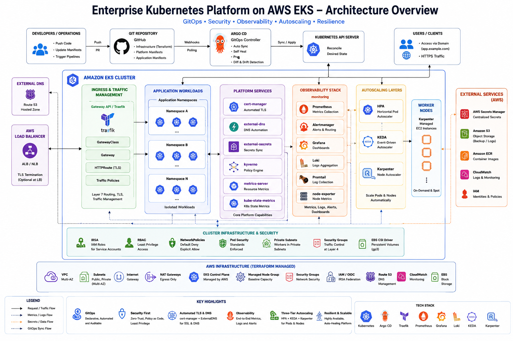

# Enterprise Kubernetes Platform Architecture

This document describes the technical architecture of the **Enterprise Kubernetes Platform Engineering** project built on Amazon EKS.

The platform was designed to demonstrate how a platform engineering team can provide development teams with a standardized Kubernetes environment that is:

- reproducible
- secure
- observable
- scalable
- GitOps-managed
- policy-controlled
- integrated with AWS services

The objective was not simply to provision an EKS cluster. The objective was to build the surrounding platform capabilities normally required to operate Kubernetes workloads in a production-oriented environment.

---

# 1. High-Level Architecture

The platform combines AWS infrastructure, Kubernetes platform services, GitOps, security controls, observability, and multiple autoscaling layers.


```text
                           Developers
                               |
                               | Git commit / pull request
                               v
                         +-------------+
                         |   GitHub    |
                         | Desired     |
                         | State       |
                         +------+------+
                                |
                                v
                         +-------------+
                         |   Argo CD   |
                         |   GitOps    |
                         +------+------+
                                |
                                v
+------------------------------------------------------------------+
|                         Amazon EKS                               |
|                                                                  |
|  Networking               Security              Observability    |
|  ----------               --------              -------------    |
|  Gateway API              Kyverno               Prometheus       |
|  Traefik                  NetworkPolicy         Grafana          |
|  ExternalDNS              External Secrets      Alertmanager     |
|  cert-manager             IRSA                  node-exporter     |
|                                                                  |
|  Autoscaling              Storage                                |
|  -----------              -------                                |
|  HPA                      EBS CSI                                |
|  KEDA                     gp3 StorageClass                       |
|  Karpenter                                                       |
|                                                                  |
|                     Application Workloads                        |
+-------------------------------+----------------------------------+
                                |
                                v
+------------------------------------------------------------------+
|                              AWS                                 |
|                                                                  |
|  VPC | EC2 | IAM | EBS | Route 53 | CloudWatch | Secrets Manager|
+------------------------------------------------------------------+
```
---

# 2. Architectural Principles

The platform follows several engineering principles.

## Infrastructure as Code

AWS infrastructure is provisioned using Terraform rather than manually created through the AWS Console.

## GitOps

Kubernetes platform configuration is stored in Git and reconciled by Argo CD.

## Least Privilege

AWS permissions are separated using dedicated IAM roles and IRSA rather than broad worker-node permissions.

## Private Worker Infrastructure

EKS worker nodes operate in private subnets rather than being directly exposed to the Internet.

## Policy as Code

Kyverno enforces workload security and resource requirements through Kubernetes admission control.

## Zero-Trust Networking

Application namespaces use default-deny Kubernetes NetworkPolicies with explicitly permitted traffic.

## Observability by Default

Prometheus and Grafana provide visibility into infrastructure and workload health.

## Layered Autoscaling

Different autoscaling technologies solve different scaling problems:
```
HPA        -> resource-based pod scaling
KEDA       -> external/event-driven pod scaling
Karpenter  -> infrastructure/node scaling
```
---

# 3. AWS Infrastructure Architecture

Terraform provisions the AWS infrastructure required by the Kubernetes platform.

The infrastructure includes:
```
terraform/aws/

VPC
├── Public Subnets
├── Private Subnets
├── Internet Gateway
├── NAT Gateway
└── Route Tables

Amazon EKS
├── Managed Control Plane
├── Managed Node Group
├── Cluster Security Groups
└── EKS Add-ons

IAM
├── Cluster Role
├── Worker Node Role
├── OIDC Provider
├── IRSA Roles
└── Karpenter Roles and Policies
```
The VPC spans multiple Availability Zones.

Worker nodes run in private subnets while public-facing load-balancing infrastructure uses public networking.

Conceptually:
```
                    AWS VPC

          +-------------+-------------+
          |                           |
          v                           v

     Availability                 Availability
       Zone A                       Zone B

     Public Subnet                Public Subnet
          |                           |
     Private Subnet               Private Subnet
          |                           |
       EKS Nodes                   EKS Nodes
```
This prevents worker nodes from requiring direct Internet exposure.

Outbound connectivity from private subnets is provided through a NAT Gateway.

---

# 4. Amazon EKS Architecture

Amazon EKS provides the managed Kubernetes control plane.

AWS operates the control-plane infrastructure, including:
```
Kubernetes API server
etcd
control-plane availability
integration with AWS infrastructure
```
The platform retains an EKS Managed Node Group for stable baseline compute.

This is intentional.
```
Stable platform workloads
        |
        v
EKS Managed Node Group

Dynamic application capacity
        |
        v
Karpenter
```
Platform-critical components such as Argo CD, Kyverno, KEDA, cert-manager, Prometheus, and Karpenter therefore do not depend entirely on dynamically provisioned nodes.

The cluster also uses EKS integrations including:
```
CoreDNS
kube-proxy
Amazon VPC CNI
Amazon EBS CSI Driver
```
---

# 5. Identity and AWS Access

The platform uses IAM Roles for Service Accounts to avoid giving Kubernetes workloads unnecessary AWS permissions.

The trust model is:
```
Kubernetes ServiceAccount
          |
          v
    EKS OIDC Provider
          |
          v
       IAM Role
          |
          v
     AWS Permissions
```
Examples include dedicated IAM access for:
```
ExternalDNS
External Secrets Operator
Amazon EBS CSI Driver
Amazon VPC CNI
Karpenter
```
For example:
```
ExternalDNS
    |
    v
ServiceAccount
    |
    v
IRSA Role
    |
    v
Route 53
```
Only the ExternalDNS workload receives the Route 53 permissions it requires.

This follows the principle of least privilege.

---

# 6. GitOps Architecture

Argo CD manages Kubernetes desired state from Git.
```
GitHub Repository
       |
       v
    Argo CD
       |
       v
Kubernetes API
       |
       v
Cluster Resources
```
The repository acts as the source of truth for platform configuration.

The project uses the App-of-Apps pattern.
```
enterprise-platform
|
+-- cert-manager
+-- external-dns
+-- external-secrets
+-- gateway-api-crds
+-- traefik-gateway
+-- kyverno
+-- kyverno-policies
+-- network-policies
+-- observability
+-- metrics-server
+-- keda
+-- keda-scaledobjects
+-- karpenter
+-- karpenter-resources
```
This provides an independent lifecycle and health boundary for each platform component.

Argo CD also uses an AppProject to restrict:
```
approved source repositories
destinations
namespaces
cluster-scoped resources
namespace-scoped resources
```
This provides governance around GitOps deployments rather than giving every application unrestricted cluster access.

---

# 7. Application Traffic Architecture

The project uses Kubernetes Gateway API rather than relying only on traditional Ingress resources.

The request path is:
```
Internet
   |
   v
Route 53
   |
   v
AWS Load Balancer
   |
   v
Traefik
   |
   v
Gateway
   |
   v
HTTPRoute
   |
   v
Service
   |
   v
Application Pod
```
Gateway API separates infrastructure ownership from application routing.

The platform team can manage shared gateway infrastructure while application teams manage application-specific routes.

---

# 8. DNS and TLS Automation
## ExternalDNS

ExternalDNS observes Kubernetes networking resources and manages Route 53 DNS records.
```
Gateway / HTTPRoute
        |
        v
    ExternalDNS
        |
        v
      Route 53
```
This removes the need for separate manual DNS changes during application deployment.

## cert-manager

cert-manager manages TLS certificate lifecycle.
```
Certificate
     |
     v
cert-manager
     |
     v
ACME Provider
     |
     v
Certificate Issued
     |
     v
Kubernetes TLS Secret
```
The TLS Secret is then consumed by the Gateway configuration.

DNS and TLS therefore become declarative parts of the platform rather than manual operational tasks.

---

# 9. Secrets Architecture

Sensitive values are not stored directly in Git.

External Secrets Operator integrates Kubernetes workloads with AWS Secrets Manager.
```
Git
 |
 | ExternalSecret definition
 v
External Secrets Operator
 |
 v
AWS Secrets Manager
 |
 v
Kubernetes Secret
 |
 v
Application
```
Git contains the declaration describing which secret is required, while the actual secret value remains outside the repository.

---

# 10. Kubernetes Security Architecture

Security is implemented through multiple independent controls.
```
AWS Security
├── IAM
├── IRSA
├── Private Subnets
└── Security Groups

Kubernetes Security
├── RBAC
├── Kyverno
├── NetworkPolicy
└── Namespace boundaries

Secrets
└── External Secrets Operator

Transport Security
└── TLS / cert-manager

GitOps Governance
└── Argo CD AppProject
```
## Kyverno

Kyverno provides policy-as-code enforcement through Kubernetes admission control.
```
kubectl apply
      |
      v
Kubernetes API
      |
      v
Kyverno Webhook
      |
   +--+--+
   |     |
 PASS   FAIL
   |     |
   v     v
Create  Reject
```
Validated policies include:
```
blocking privileged containers
requiring CPU requests
requiring memory requests
requiring CPU limits
requiring memory limits
```
The policies were validated using negative tests where intentionally non-compliant Pods were rejected by the admission webhook.

## NetworkPolicy

The application namespace follows a default-deny posture.
```
Ingress = DENY by default
Egress  = DENY by default
```
Only required communication is explicitly allowed.

Examples include:
```
Traefik
   |
   v
Application Pods
```
and:
```
Application Pods
       |
       v
      DNS
```
This limits unnecessary east-west network communication.

---

# 11. Observability Architecture

The observability platform is based on the Prometheus ecosystem.
```
Kubernetes
    |
    v
Metrics Endpoints
    |
    v
Prometheus
   / \
  /   \
 v     v
Grafana  Alertmanager
```
The stack includes:
```
Prometheus Operator
Prometheus
Grafana
Alertmanager
kube-state-metrics
node-exporter
```
Prometheus Operator allows monitoring resources such as ServiceMonitor and PrometheusRule to be managed declaratively.

Grafana provides visualization of cluster and workload metrics.

Metrics Server serves a different purpose.
```
Metrics Server
      |
      +--> kubectl top
      |
      +--> HPA resource metrics

Prometheus
      |
      +--> monitoring
      |
      +--> historical metrics
      |
      +--> alerting
      |
      +--> KEDA external metrics
```
---

# 12. Autoscaling Architecture

The platform intentionally implements three autoscaling layers.
```
                 APPLICATION DEMAND
                         |
            +------------+------------+
            |                         |
            v                         v
           HPA                       KEDA
            |                         |
            +------------+------------+
                         |
                         v
                   More Pods
                         |
                         v
                 Kubernetes Scheduler
                         |
                  Capacity Available?
                         |
                   +-----+-----+
                   |           |
                  Yes          No
                   |           |
                   v           v
              Schedule     Karpenter
                              |
                              v
                          NodeClaim
                              |
                              v
                         EC2 Instance
                              |
                              v
                       Kubernetes Node
```
## HPA

Horizontal Pod Autoscaler handles traditional resource-based replica scaling.

Example:
```
CPU increases
    |
    v
Metrics Server
    |
    v
HPA
    |
    v
More replicas
```

## KEDA

KEDA provides external and event-driven autoscaling.

This project integrates KEDA with Prometheus.
```
Application Metric
       |
       v
   Prometheus
       |
       v
      KEDA
       |
       v
ScaledObject
       |
       v
      HPA
       |
       v
Deployment Replicas
```
## Karpenter

Karpenter handles infrastructure scaling.

When Pods cannot be scheduled because existing nodes lack capacity:
```
Pending Pod
    |
    v
Karpenter
    |
    v
NodeClaim
    |
    v
EC2 Instance
    |
    v
Node Registers
    |
    v
Pod Scheduled
```
The project successfully validated this workflow by forcing a workload onto Karpenter-managed capacity.

Karpenter created:
```
a NodeClaim
an EC2 instance
a Kubernetes node
```
The workload then became Running.

After the workload was removed, consolidation removed the unnecessary compute capacity.

---

# 13. Karpenter Node Architecture

Karpenter uses two important resources.

## EC2NodeClass

EC2NodeClass defines AWS-specific infrastructure configuration including:
```
AMI selection
IAM node role
subnet discovery
security-group discovery
block-device configuration
AWS tags
```
The project uses:
```
karpenter.sh/discovery
```
tags so Karpenter can locate the correct subnets and security groups.

## NodePool

NodePool defines scheduling and infrastructure constraints such as:
```
Linux
amd64 architecture
EC2 instance categories
instance-generation requirements
Spot and On-Demand capability
CPU limits
memory limits
consolidation policy
```
This provides guardrails without hard-coding a single EC2 instance type.

---

# 14. Persistent Storage

Persistent storage is provided through the Amazon EBS CSI Driver.
```
Application
    |
    v
PersistentVolumeClaim
    |
    v
StorageClass
    |
    v
EBS CSI Driver
    |
    v
Amazon EBS
```
The platform defines a gp3 StorageClass using:
```
ebs.csi.aws.com
```
with volume expansion enabled.

---

# 15. Platform Recovery Model

A major goal of the project is infrastructure reproducibility.

AWS infrastructure can be recreated using Terraform.
```
Terraform
    |
    v
VPC + IAM + EKS
```
Kubernetes platform services can then be restored through GitOps.
```
EKS Cluster
    |
    v
Argo CD Bootstrap
    |
    v
Root Application
    |
    v
Platform Applications
    |
    v
Desired State Restored
```
This creates a recovery model based primarily on:
```
Terraform State
      +
Git Repository
```
rather than undocumented manual cluster configuration.

A complete stateful application backup and restore implementation using Velero is intentionally treated as a future enhancement rather than claiming functionality that was not fully validated.

---

# 16. Separation of Responsibilities

The architecture reflects the separation commonly found in larger engineering organizations.

## Infrastructure / Cloud Engineering

Responsible for:
```
AWS networking
EKS
IAM
Terraform
baseline compute
Platform Engineering

Responsible for:

Argo CD
Gateway API
Traefik
ExternalDNS
cert-manager
secrets integration
Kyverno
NetworkPolicies
observability
autoscaling
storage integration
```
## Application Teams

Responsible for:
```
container images
Deployments
Services
application configuration
resource requests and limits
application routes
application-specific scaling policies
```
This prevents every development team from independently solving the same infrastructure problems.

---

# 17. Repository Architecture

The repository separates infrastructure, platform components, GitOps configuration, and application definitions.
```
eks-enterprise-kubernetes-platform/
|
+-- terraform/
|   +-- aws/
|
+-- argocd/
|   +-- applications/
|   +-- app-of-apps/
|   +-- projects/
|
+-- platform/
|   +-- cert-manager/
|   +-- external-dns/
|   +-- external-secrets/
|   +-- gateway-api/
|   +-- karpenter/
|   +-- keda/
|   +-- kyverno/
|   +-- metrics-server/
|   +-- network-policies/
|   +-- observability/
|   +-- storage/
|   +-- traefik-gateway/
|
+-- applications/
|   +-- online-boutique/
|
+-- clusters/
|   +-- dev/
|   +-- staging/
|   +-- prod/
|
+-- docs/
|
+-- diagrams/
|
+-- README.md
```
This structure separates AWS infrastructure from Kubernetes desired state while allowing both to remain version controlled.

---

# 18. End-to-End Platform Flow

A production request travels through multiple platform layers.
```
                        USER
                         |
                         v
                      DNS
                         |
                         v
                     Route 53
                         |
                         v
                AWS Load Balancer
                         |
                         v
                     Traefik
                         |
                         v
                   Gateway API
                         |
                         v
                    HTTPRoute
                         |
                         v
                     Service
                         |
                         v
                       Pod
```
Around the workload:
```
Prometheus
    |
    +--> observes

Grafana
    |
    +--> visualizes

Kyverno
    |
    +--> governs

NetworkPolicy
    |
    +--> isolates

External Secrets
    |
    +--> supplies secrets

HPA / KEDA
    |
    +--> scale replicas

Karpenter
    |
    +--> scales infrastructure
```
This interaction between independent controllers is what transforms an EKS cluster into a Kubernetes platform.

---

# 19. Key Engineering Decisions

Several architectural decisions were intentional.

## EKS rather than self-managed Kubernetes

The project focuses engineering effort on platform capabilities rather than manually operating Kubernetes control-plane infrastructure.

## Private worker nodes

Worker nodes do not require direct Internet exposure.

## Terraform for AWS infrastructure

Infrastructure changes are reviewable, repeatable, and version controlled.

## Argo CD for Kubernetes desired state

Git becomes the source of truth for platform configuration.

## Gateway API instead of only Ingress

Gateway API provides clearer separation between shared infrastructure and application routing.

## IRSA instead of broad worker-node IAM permissions

AWS permissions are assigned at workload identity level.

## Kyverno instead of policy documentation alone

Security rules are automatically enforced.

## Default-deny NetworkPolicies

Network access is explicitly permitted rather than implicitly trusted.

## HPA + KEDA + Karpenter

Each autoscaler solves a different layer of the scaling problem.

## Managed Node Group + Karpenter

Stable baseline platform capacity is separated from elastic workload capacity.

## Prometheus + Metrics Server

Operational monitoring and Kubernetes resource metrics are treated as different concerns.

---

# 20. Architecture Validation

The platform was validated through operational testing rather than only static configuration.

Validation included:
```
EKS node readiness
Argo CD application reconciliation
Gateway API readiness
HTTPRoute routing
ExternalDNS operation
cert-manager deployment
External Secrets deployment
Kyverno admission enforcement
Kubernetes NetworkPolicies
Prometheus and Grafana
Metrics Server
KEDA ScaledObject readiness
Karpenter EC2NodeClass readiness
Karpenter NodePool readiness
dynamic Karpenter NodeClaim creation
EC2 node provisioning
workload scheduling on Karpenter capacity
Karpenter consolidation
gp3 StorageClass availability
absence of unexpected Pending or Failed Pods
```
The Karpenter validation demonstrated the complete elasticity chain:
```
Unschedulable Pod
        |
        v
Karpenter detects demand
        |
        v
NodeClaim created
        |
        v
EC2 instance launched
        |
        v
Node joins EKS
        |
        v
Pod becomes Running
        |
        v
Workload removed
        |
        v
Karpenter consolidates node
        |
        v
EC2 capacity terminated
```
---

# 21. Evidence and Screenshots

During the final clean deployment, selected screenshots will be captured to demonstrate the running platform.

Planned evidence includes:
```
docs/images/

aws-eks-cluster.png
argocd-platform-applications.png
gateway-api.png
grafana-kubernetes-dashboard.png
keda-scaledobject.png
karpenter-nodeclaim.png
karpenter-node.png
final-platform-health.png
```
Only screenshots that provide meaningful technical evidence will be included.

The repository source code remains the primary evidence of implementation.

---

# 22. Final Architecture Summary

The final platform combines:
```
Terraform
    +
Amazon EKS
    +
GitOps / Argo CD
    +
Gateway API / Traefik
    +
ExternalDNS
    +
cert-manager
    +
External Secrets
    +
Kyverno
    +
NetworkPolicy
    +
Prometheus / Grafana
    +
HPA
    +
KEDA
    +
Karpenter
    +
EBS CSI
```
The result is a reproducible Kubernetes platform where:
```
AWS infrastructure is provisioned through Terraform
Kubernetes desired state is stored in Git
Argo CD continuously reconciles platform configuration
AWS permissions follow workload-level least privilege
application networking follows a default-deny model
workload policies are automatically enforced
DNS and TLS lifecycle are automated
metrics and cluster health are observable
Pods can scale horizontally
external metrics can drive application scaling
EC2 compute capacity can scale dynamically
persistent storage is integrated with Amazon EBS
```
The architecture demonstrates the transition from simply running Kubernetes to engineering a managed internal Kubernetes platform.
